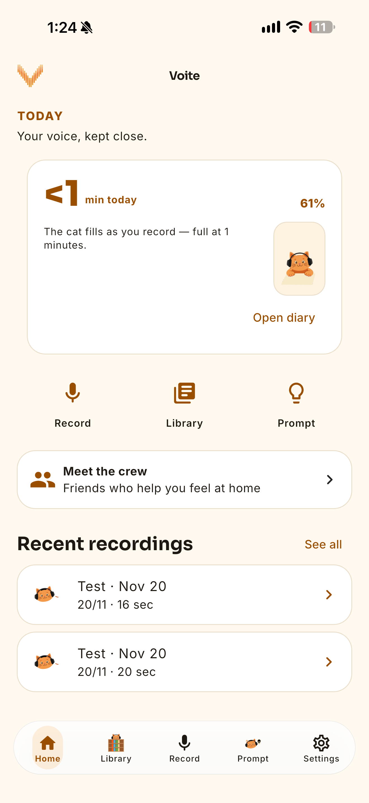
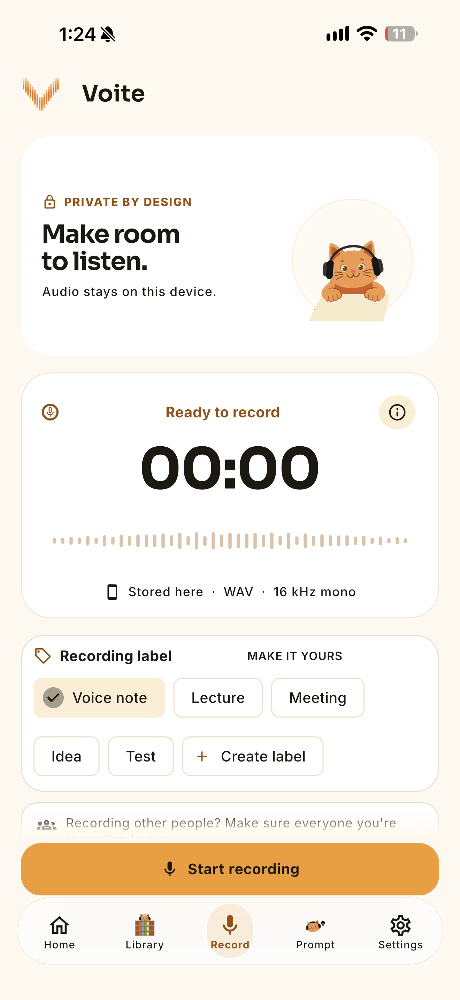
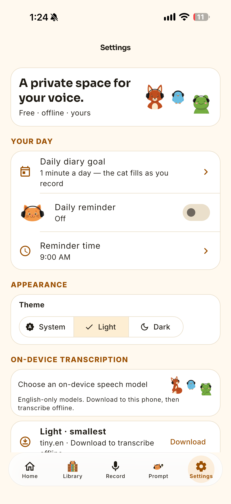
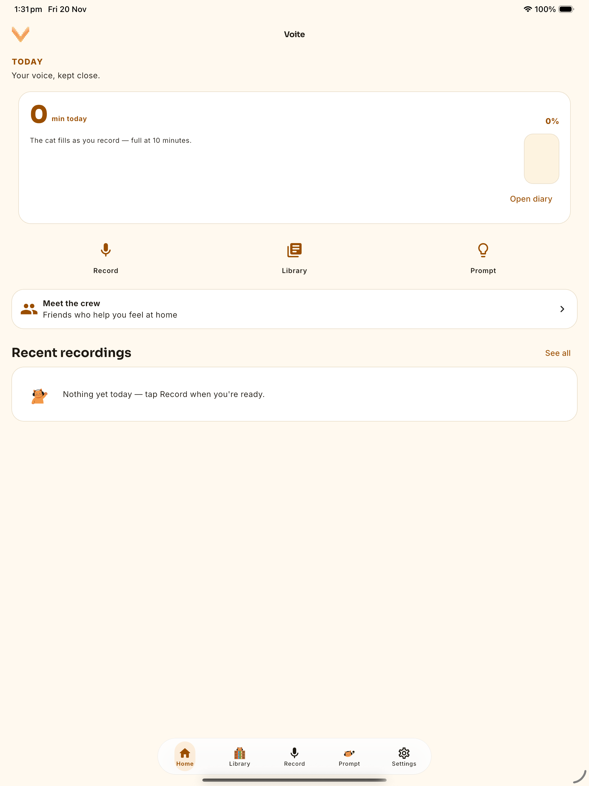
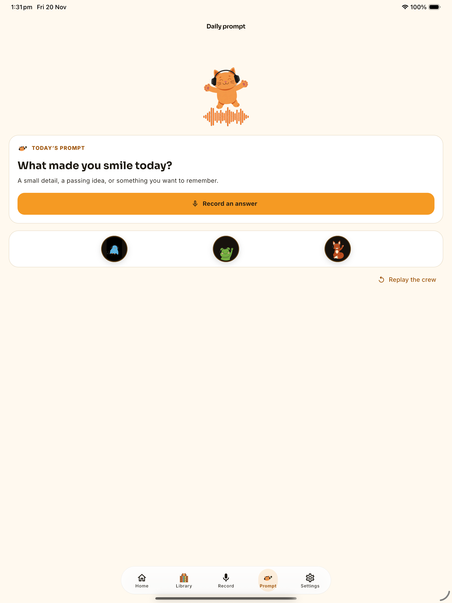
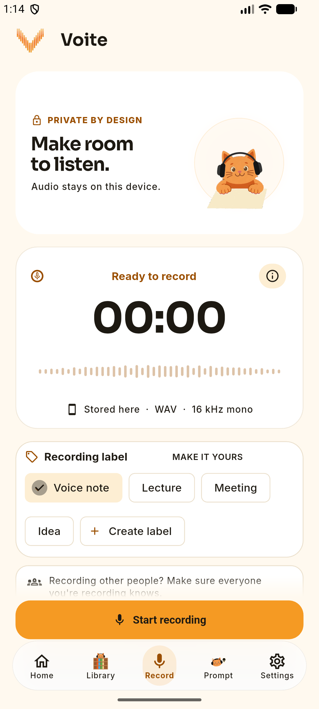
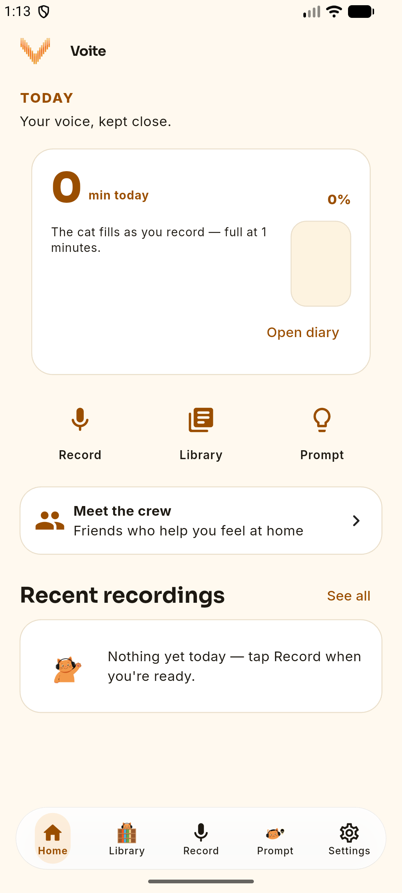
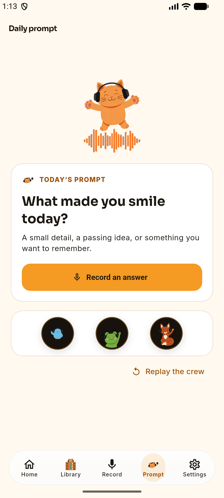

# 📸 Screenshot Capture Guide - Build 2282

We need **9 screenshots total** (3 per platform) showing the same 3 screens on each device.

## Required Screenshots

| Platform | Record Screen | Home Screen | Daily Prompt Screen |
|----------|--------------|-------------|---------------------|
| **iPhone** | ✅ Recording UI | ✅ Cat + Today | ✅ Thought prompts |
| **iPad** | ✅ Recording UI | ✅ Cat + Today | ✅ Thought prompts |
| **Android** | ✅ Recording UI | ✅ Cat + Today | ✅ Thought prompts |

---

## Step-by-Step Instructions

### 🍎 iOS iPhone (iPhone 17 Pro Max Simulator)

1. **Start the simulator:**
   ```bash
   cd "/Users/aashish/Github projects /voice-recorder-plan-20261110"
   open -a Simulator
   # Select: iPhone 17 Pro Max from menu
   fvm flutter run -d "iPhone 17 Pro Max"
   ```

2. **Navigate and capture:**
   - Wait for app to launch
   - **Click "Get Started"** to complete onboarding
   - You'll land on the **Record screen** (bottom tab 1)
   - **Screenshot 1:** `Cmd+S` → Save as `iphone-record.png`
   
   - Tap the **Home tab** (second from left)
   - **Screenshot 2:** `Cmd+S` → Save as `iphone-home.png`
   
   - Tap the **Daily Prompt tab** (middle tab with star/thought icon)
   - **Screenshot 3:** `Cmd+S` → Save as `iphone-prompt.png`

3. **Copy to repository:**
   ```bash
   cp ~/Desktop/iphone-record.png docs/screenshots/
   cp ~/Desktop/iphone-home.png docs/screenshots/
   cp ~/Desktop/iphone-prompt.png docs/screenshots/
   ```

---

### 📱 iPad (iPad Pro 13-inch Simulator)

1. **Start iPad simulator:**
   ```bash
   # Stop iPhone first
   # In Simulator: File → Open Simulator → iPad Pro 13-inch (M5)
   fvm flutter run -d "iPad Pro"
   ```

2. **Navigate and capture:**
   - Complete onboarding (Get Started)
   - **Record screen:** `Cmd+S` → `ipad-record.png`
   - **Home screen:** `Cmd+S` → `ipad-home.png`
   - **Daily Prompt:** `Cmd+S` → `ipad-prompt.png`

3. **Copy to repository:**
   ```bash
   cp ~/Desktop/ipad-record.png docs/screenshots/
   cp ~/Desktop/ipad-home.png docs/screenshots/
   cp ~/Desktop/ipad-prompt.png docs/screenshots/
   ```

---

### 🤖 Android (Emulator or Physical Device)

#### Option A: Emulator
1. **Launch emulator:**
   ```bash
   fvm flutter emulators --launch Medium_Phone_API_37.0
   # Wait 30 seconds for emulator to boot
   fvm flutter run -d "Medium Phone"
   ```

2. **Navigate and capture:**
   - Complete onboarding
   - **Record screen:** Screenshot tool → `android-record.png`
   - **Home screen:** Screenshot tool → `android-home.png`
   - **Daily Prompt:** Screenshot tool → `android-prompt.png`

3. **Pull screenshots from emulator:**
   ```bash
   # Screenshots are in /sdcard/Pictures/Screenshots/
   adb pull /sdcard/Pictures/Screenshots/Screenshot_*.png ~/Desktop/
   # Rename them appropriately
   ```

#### Option B: Physical Device (Easier!)
1. **Install APK on your Android phone:**
   ```bash
   # If you have an Android device connected:
   fvm flutter install
   # Or manually install the APK from releases
   ```

2. **Take screenshots:**
   - Open Voite
   - Complete onboarding
   - **Record screen:** Power + Volume Down → `android-record.png`
   - **Home screen:** Power + Volume Down → `android-home.png`
   - **Daily Prompt:** Power + Volume Down → `android-prompt.png`

3. **Transfer to Mac:**
   - Use Google Photos, or
   - USB transfer, or
   - Email to yourself

---

## Quick Copy Script

Once you have all 9 screenshots on your Desktop:

```bash
cd "/Users/aashish/Github projects /voice-recorder-plan-20261110"

# Remove old screenshots
rm -f docs/screenshots/*.png

# Copy iPhone
cp ~/Desktop/iphone-record.png docs/screenshots/
cp ~/Desktop/iphone-home.png docs/screenshots/
cp ~/Desktop/iphone-prompt.png docs/screenshots/

# Copy iPad  
cp ~/Desktop/ipad-record.png docs/screenshots/
cp ~/Desktop/ipad-home.png docs/screenshots/
cp ~/Desktop/ipad-prompt.png docs/screenshots/

# Copy Android
cp ~/Desktop/android-record.png docs/screenshots/
cp ~/Desktop/android-home.png docs/screenshots/
cp ~/Desktop/android-prompt.png docs/screenshots/

# Also create the main 3 for README (using iPhone as default)
cp ~/Desktop/iphone-record.png docs/screenshots/record.png
cp ~/Desktop/iphone-home.png docs/screenshots/home.png
cp ~/Desktop/iphone-prompt.png docs/screenshots/daily-prompt.png

# Commit and push
git add docs/screenshots/
git commit -m "docs: add proper screenshots for all 3 platforms

- iPhone 17 Pro Max: Record, Home, Daily Prompt
- iPad Pro 13-inch: Record, Home, Daily Prompt  
- Android: Record, Home, Daily Prompt
- All from build 2282 after completing onboarding"
git push origin main
```

---

## README Table Update

After capturing, update the README to show 3 tables:

```markdown
### iPhone 17 Pro Max
| Record | Home | Daily prompt |
| --- | --- | --- |
|  |  |  |

### iPad Pro (13-inch)
| Record | Home | Daily prompt |
| --- | --- | --- |
|  |  |  |

### Android
| Record | Home | Daily prompt |
| --- | --- | --- |
|  |  |  |
```

---

## Screen Identification Guide

### 🎙️ Record Screen
- **Location:** Bottom tab bar → First tab (leftmost)
- **Look for:** Large red/orange record button in center
- **Should show:** Waveform area, timer, record button, bottom navigation

### 🏠 Home Screen  
- **Location:** Bottom tab bar → Second tab
- **Look for:** "TODAY" heading at top, cat progress indicator
- **Should show:** Cat filling with water, recent recordings list, daily goal

### 💭 Daily Prompt Screen
- **Location:** Bottom tab bar → Third tab (middle, star icon)
- **Look for:** Thought-provoking questions/prompts
- **Should show:** "Today's prompt" or similar, companion character, "Start Recording" button

---

## Tips

✅ **DO:**
- Complete onboarding first (tap "Get Started", swipe through)
- Take screenshots AFTER onboarding
- Use landscape on iPad to show responsive layout
- Ensure good lighting (simulators look best)
- Keep device frame visible (no cropping)

❌ **DON'T:**
- Take screenshots during onboarding
- Include personal recording data
- Crop out status bar or navigation
- Use dark mode (keep light mode for consistency)

---

## Checklist

Before committing, verify you have:
- [ ] 3 iPhone screenshots (record, home, prompt)
- [ ] 3 iPad screenshots (record, home, prompt)
- [ ] 3 Android screenshots (record, home, prompt)
- [ ] All show DIFFERENT screens (not onboarding)
- [ ] All from build 2282
- [ ] Good quality and resolution
- [ ] Consistent light mode theme

---

**Goal:** Show that Voite works beautifully across all platforms with the same features!
