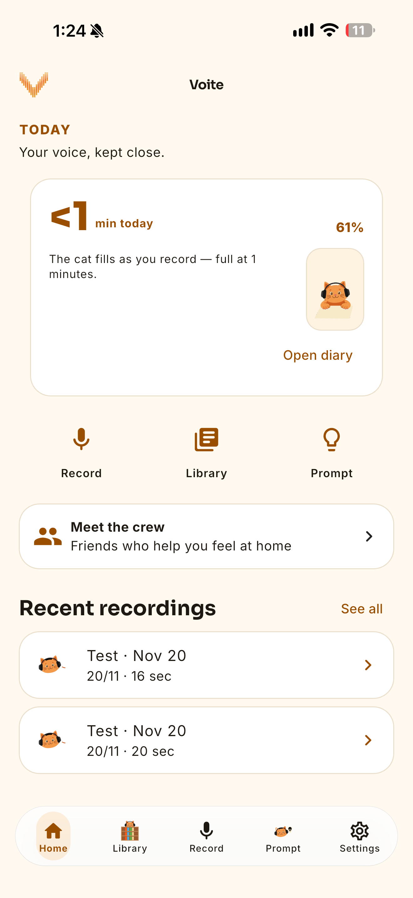
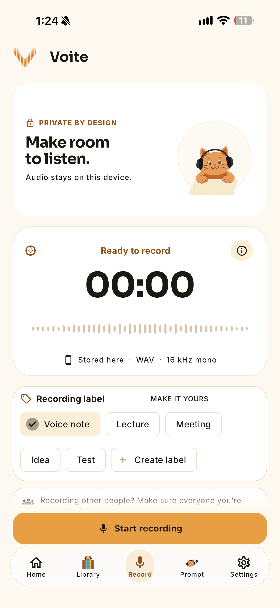
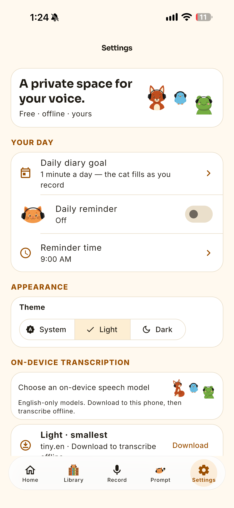
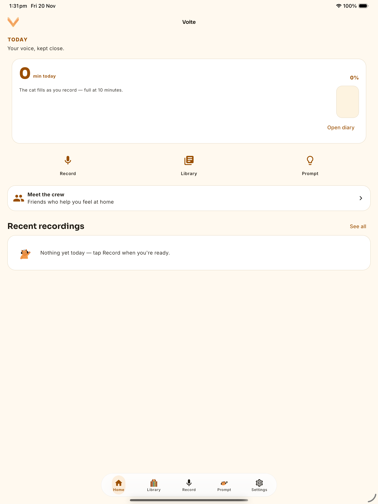
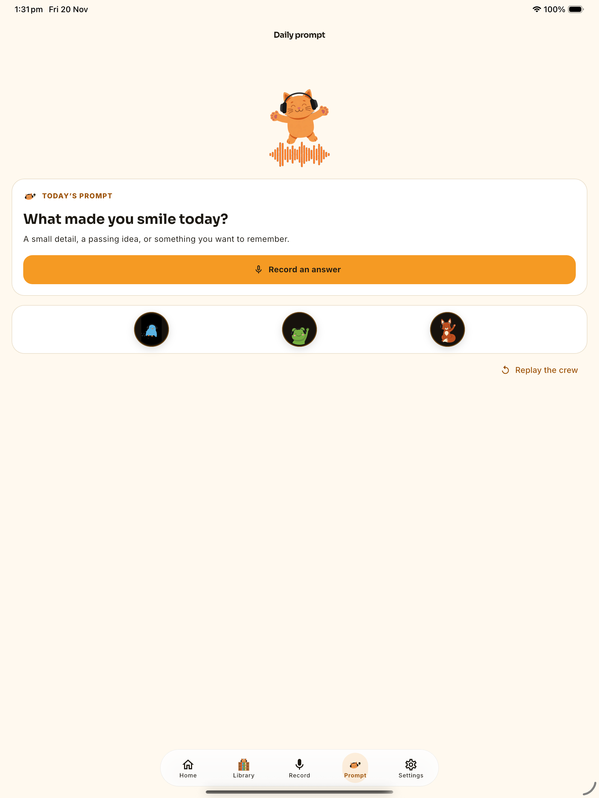
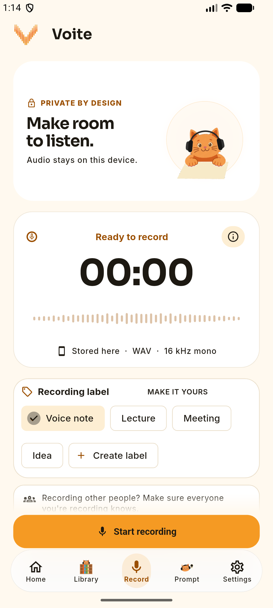
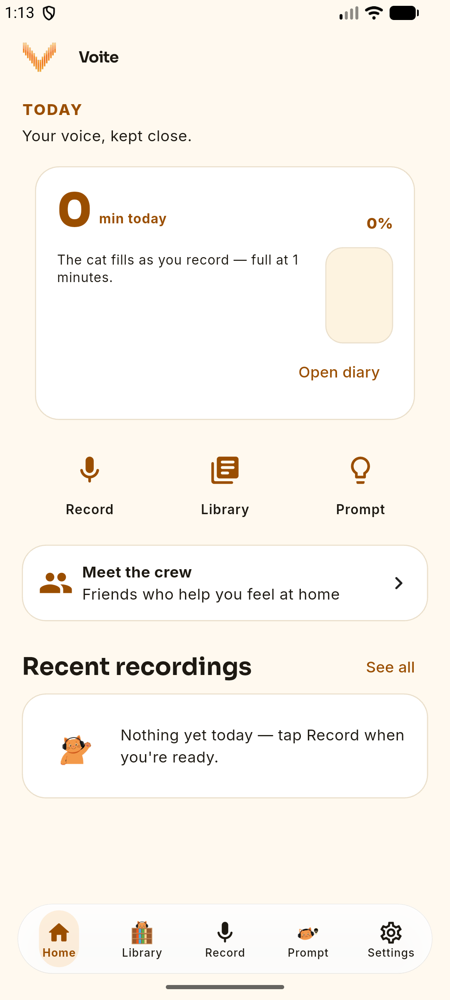
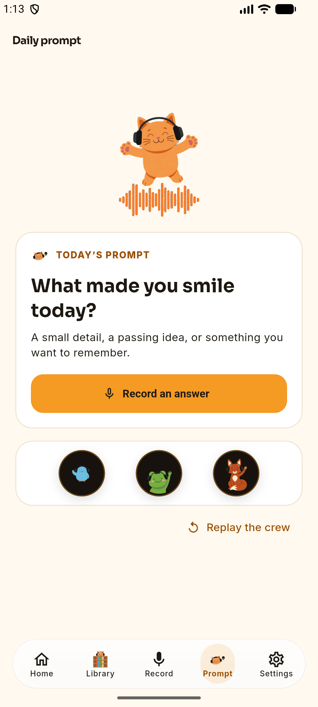

# Voite

<p align="center">
  
</p>

<p align="center">
  <strong>Private, offline voice recorder and diary with on-device transcription.</strong><br />
  Built by <a href="https://github.com/locvel">Locvel</a>.
</p>

<p align="center">
  <a href="https://github.com/locvel/voite/releases/latest"></a>
  <a href="https://github.com/locvel/voite/actions/workflows/ci.yml"></a>
  <a href="LICENSE"></a>
  
  
  <a href="https://github.com/locvel/voite/stargazers"></a>
</p>

<p align="center">
  <a href="https://github.com/locvel/voite/releases/latest/download/app-release.apk">
    
  </a>
  <a href="https://github.com/locvel/voite/releases/latest">
    
  </a>
</p>

---

## 📺 Video Tutorial

Watch our complete tutorial on how to use Voite:

<p align="center">
  <a href="https://youtu.be/El_ou_v5tWA">
    
  </a>
</p>

<p align="center">
  <a href="https://youtu.be/El_ou_v5tWA">
    
  </a>
</p>

Learn how to record, transcribe, and manage your voice notes with Voite's privacy-first approach.

---

Voite is a Flutter app for capturing voice notes, lectures, meetings, and
passing ideas. Recordings, transcripts, and diary entries stay in the app's
private storage on the phone. There is no account, advertising, analytics,
automatic cloud sync, or voicemail/call recording.

Transcription is optional. After the user downloads an English Whisper model,
speech recognition runs on the device with
[sherpa-onnx](https://github.com/k2-fsa/sherpa-onnx). Audio is never uploaded for
transcription.

### Screenshots

#### iPhone 17 Pro Max
| Record | Home | Daily Prompt |
| --- | --- | --- |
|  |  |  |

#### iPad Pro 13-inch
| Record | Home | Daily Prompt |
| --- | --- | --- |
|  |  |  |

#### Android
| Record | Home | Daily Prompt |
| --- | --- | --- |
|  |  |  |

## Features

- One-tap recording with pause, resume, stop, and crash/restart recovery.
- Local library with search, labels, favorites, and a 30-day Recently Deleted
  folder.
- Optional on-device English transcription from downloadable Whisper models.
- Diary entries with editable titles and transcripts; delete an entry while
  keeping its audio.
- Audio playback, transcript seeking, copy/share transcript text, and share WAV
  audio through the system share sheet.
- Diary export as a PDF or plain text, plus recording-detail export.
- Daily prompts, a 10-minute daily goal, and the Voite companion animations.
- Android foreground-service recording notification and optional daily reminder.
- **Universal app**: Works on phones, tablets, and iPad with responsive layouts.
- Portrait and landscape orientations supported on all devices.

## Privacy model

- Recordings and transcripts are stored inside the app sandbox.
- The metadata database is encrypted at rest with SQLCipher; the key is kept in
  Android Keystore or the iOS Keychain.
- Audio is stored as 16 kHz mono WAV. **The WAV files themselves are not
  separately encrypted by Voite**; they rely on OS app-storage protections.
- The internet is used only for optional model downloads and when the user
  chooses to share or export content.
- Backups are disabled for the database, recordings, and models.
- The app contains no analytics, advertising, crash-reporting, or tracking SDKs.

Read the full [privacy policy](https://locvel.github.io/voite/privacy.html) or
the [source Markdown](docs/privacy-policy.md). The
[privacy and security baseline](docs/PRIVACY_SECURITY_BASELINE.md) documents the
threat model and store-review considerations.

## Download

### 📱 Android (Phone & Tablet)

**[⬇️ Download APK (96.5 MB)](https://github.com/locvel/voite/releases/latest/download/app-release.apk)**

Direct download - no Google account or Play Store required. Compatible with Android 11+ (API 30) devices with arm64-v8a processors.

### 🍎 iPhone & iPad

**Easy Installation with AI Assistant (Recommended)**

Don't have Xcode experience? Use an AI coding assistant to build and install Voite automatically!

#### What You Need:
- Mac computer with macOS
- iPhone/iPad connected via USB
- [Antigravity](https://antigravity.dev), [Cursor](https://cursor.com), [Windsurf](https://codeium.com/windsurf), or [Kiro](https://kiro.dev) IDE installed
- Apple ID (free)

#### Steps:

1. **Download source code** from [latest release](https://github.com/locvel/voite/releases/latest) (Download the `Source code (zip)`)
2. **Unzip the folder** to your Mac
3. **Open the folder** in your AI IDE (Antigravity/Cursor/Windsurf/Kiro)
4. **Paste this prompt** into the AI assistant:

```
I need to build and install this Voite Flutter app on my iPhone/iPad. Please follow these steps carefully and explain what you're doing at each stage:

PREREQUISITES CHECK:
1. First, check if Homebrew is installed. If not, guide me to install it from brew.sh
2. Check if FVM (Flutter Version Manager) is installed. If not, install it via: brew tap leoafarias/fvm && brew install fvm
3. Verify the workspace contains a .fvmrc or .tool-versions file specifying Flutter 3.47.9
4. Run `fvm install` to download the correct Flutter version (3.47.9)
5. Verify Flutter installation by running `fvm flutter --version`

DEPENDENCY SETUP:
6. Run `fvm flutter pub get` to install all Dart/Flutter dependencies
7. If any dependency errors occur, run `fvm flutter pub upgrade` and retry
8. Verify ios/Podfile exists
9. Navigate to the ios/ directory and run `pod install` to install iOS native dependencies

XCODE CONFIGURATION:
10. Check that Xcode is installed (run `xcode-select -p` to verify)
11. Open the Xcode workspace: `open ios/Runner.xcworkspace` (NOT Runner.xcodeproj)
12. In Xcode, go to Runner (left sidebar) → Signing & Capabilities tab
13. Guide me to select my Apple ID as the Development Team (I'll need to add my Apple ID in Xcode → Settings → Accounts if not already added)
14. Ensure "Automatically manage signing" is checked
15. Verify the Bundle Identifier is set correctly (com.locvel.voite)

DEVICE CONNECTION:
16. Verify my iPhone/iPad is connected via USB cable
17. Run `xcrun simctl list devices` OR `idevice_id -l` to confirm device is detected
18. In Xcode, select my physical device from the device dropdown (top bar, next to Run button)
19. If device shows as "Unavailable", guide me to trust this Mac on my iPhone: Settings → General → VPN & Device Management

BUILD AND INSTALL:
20. Run the build command: `fvm flutter run -d <device-id>` OR use Xcode's Run button (⌘R)
21. Monitor the build output for any errors
22. If code signing errors occur, verify my Apple ID has the necessary permissions
23. Wait for the app to install on my device (this may take 3-5 minutes for first build)
24. Once installed, if the app crashes or shows "Untrusted Developer", guide me to trust my certificate: Settings → General → VPN & Device Management → Developer App → Trust

POST-INSTALLATION:
25. Verify the app launches successfully on my device
26. If any errors occur at ANY step, stop, explain the error in plain English, and provide the exact fix

IMPORTANT RULES:
- Explain each step BEFORE executing it
- Show me the exact commands you're running
- If something fails, don't skip it - debug it with me
- Confirm each major step completed successfully before moving to the next
- If you need information from me (like my Apple ID), ask clearly

Please start now and guide me through the entire process step-by-step.
```

5. **Follow the AI's instructions** - it will set everything up for you!
6. **Trust the certificate** on your iPhone: Settings → General → VPN & Device Management → Trust your Apple ID

**That's it!** The AI assistant handles all the technical setup.

---

**Manual Installation (Advanced Users)**

If you prefer manual setup, see the [Building](#building) section below for detailed Xcode instructions.

---

## Status

Voite is at **1.0.0** (`com.locvel.voite`). Store listings are in preparation.
The source is open for review and contributions.

### Platform Requirements

- Android 11+ (API 30), target API 36. Release APK targets `arm64-v8a` devices.
- iOS 15.0+, universal app supporting iPhone and iPad.
- Flutter 3.47.9 / Dart 3.13.7.

## Quick start

The project pins Flutter with [FVM](https://fvm.app/). Install FVM, then:

```sh
git clone https://github.com/locvel/voite.git
cd voite
fvm install
fvm flutter pub get
fvm flutter run
```

If you do not use FVM, install Flutter 3.47.9 and replace `fvm flutter` with
`flutter`.

Android builds need Android SDK Platform 36 and JDK 17. iOS builds need macOS,
Xcode, and CocoaPods.

## Checks

```sh
fvm dart format --output=none --set-exit-if-changed lib test
fvm dart analyze
fvm flutter test
```

The same checks run in [CI](.github/workflows/ci.yml) on pushes to `main` and
on pull requests.

## Building

```sh
# Android
fvm flutter build apk --release
fvm flutter build appbundle --release

# iOS
fvm flutter build ios --release
```

### Android signing

Release signing is intentionally absent from the repository. To build a signed
release locally:

```sh
cp android/key.properties.example android/key.properties
# Edit the copy with your keystore path, alias, and passwords.
```

`android/key.properties`, `*.jks`, and `*.keystore` are gitignored. Never commit
a keystore, its passwords, or Play Console service-account keys. Back up the
keystore outside the repository; losing it prevents future updates to the same
Play listing.

### iOS signing

Select your Apple development team in Xcode, or create the gitignored
`ios/Flutter/Local.xcconfig` from the example:

```sh
cp ios/Flutter/Local.xcconfig.example ios/Flutter/Local.xcconfig
# Set DEVELOPMENT_TEAM to your Apple team ID.
```

The Xcode project reads that optional file. `Local.xcconfig` must not be
committed.

## Transcription models

Model binaries are **not** included in this repository. The app downloads the
selected English Whisper ONNX files and the Silero VAD model from immutable
Hugging Face revisions, verifies every file against a SHA-256 constant compiled
into the app, and refuses an installation on a mismatch.

See [downloaded model provenance](docs/MODEL_PROVENANCE.md) for revisions,
checksums, and license notes. If you redistribute model weights, review the
upstream OpenAI Whisper and Silero VAD notices and the converted-file
provenance yourself.

## Project layout

| Path | Purpose |
| --- | --- |
| `lib/core/` | Theme, shared widgets, platform channels, storage policy |
| `lib/data/` | Drift/SQLCipher database and local repositories |
| `lib/domain/` | Models and repository interfaces |
| `lib/features/` | Recording, library, diary, prompts, onboarding, settings |
| `assets/` | Illustrations, animations, fonts, and launcher art |
| `test/` | Widget, repository, and export tests |
| `tool/` | Icon generation and app-name sync helpers |
| `benchmark/` | LibriSpeech-derived transcription benchmark fixture |
| `docs/` | Privacy, security, model, and architecture notes |

The app entry point is `lib/main.dart`; the router and shell live in
`lib/app.dart`. See [docs/ARCHITECTURE.md](docs/ARCHITECTURE.md) for the data flow.

## Contributing

Bug reports, privacy reviews, accessibility fixes, and focused pull requests are
welcome. Start with [CONTRIBUTING.md](CONTRIBUTING.md) and please follow the
[Code of Conduct](CODE_OF_CONDUCT.md).

Do not attach personal recordings, transcripts, or diary content to an issue.
Use synthetic audio or the benchmark fixture instead.

## Security

Please do not open a public issue for a vulnerability. Report it privately to
**hello.locvel@gmail.com** or through GitHub's private vulnerability reporting.
See [SECURITY.md](SECURITY.md).

## License

The source code and project assets are licensed under the
[MIT License](LICENSE), copyright © 2026 Locvel.

The **Voite** name, logo, and companion-character identities are brand
identifiers of Locvel. The MIT license does not grant trademark rights or
permission to imply endorsement. If you publish a modified build, use your own
app name and icon unless you have written permission.

Third-party libraries, fonts, benchmark audio, and model notices are listed in
[THIRD_PARTY_NOTICES.md](THIRD_PARTY_NOTICES.md).

## Contact

**Locvel** · [github.com/locvel](https://github.com/locvel) ·
hello.locvel@gmail.com
